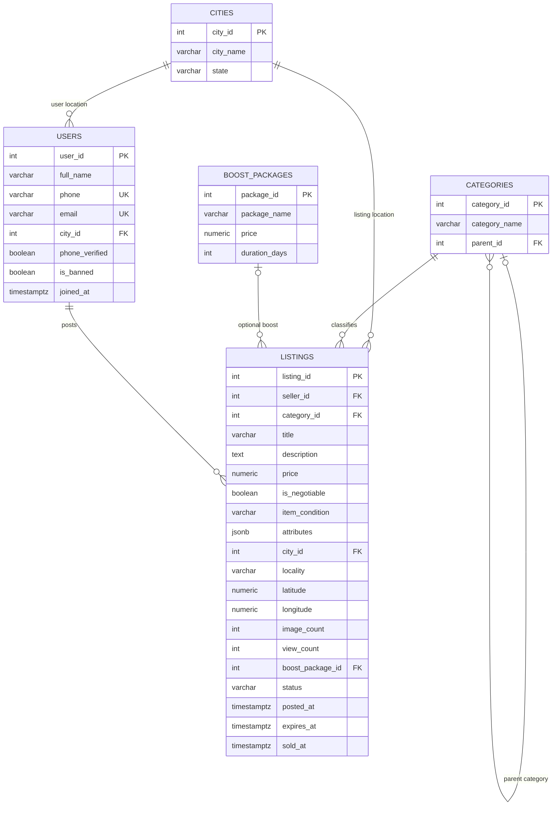
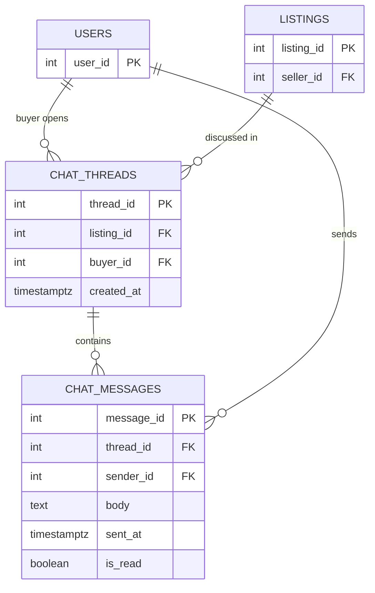
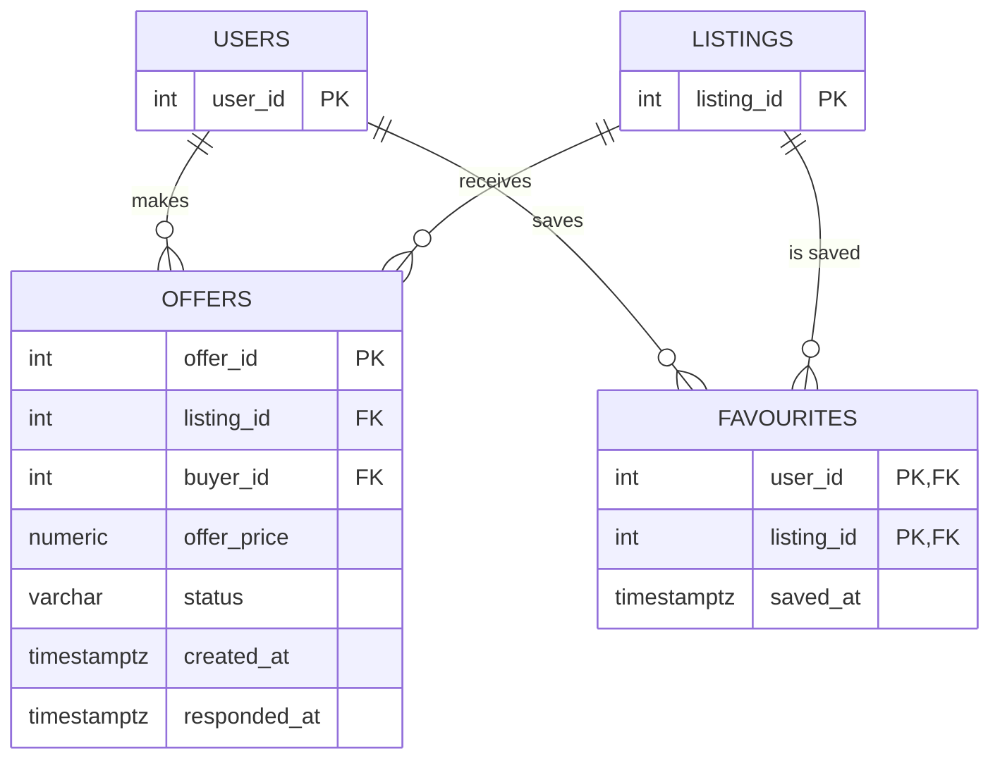
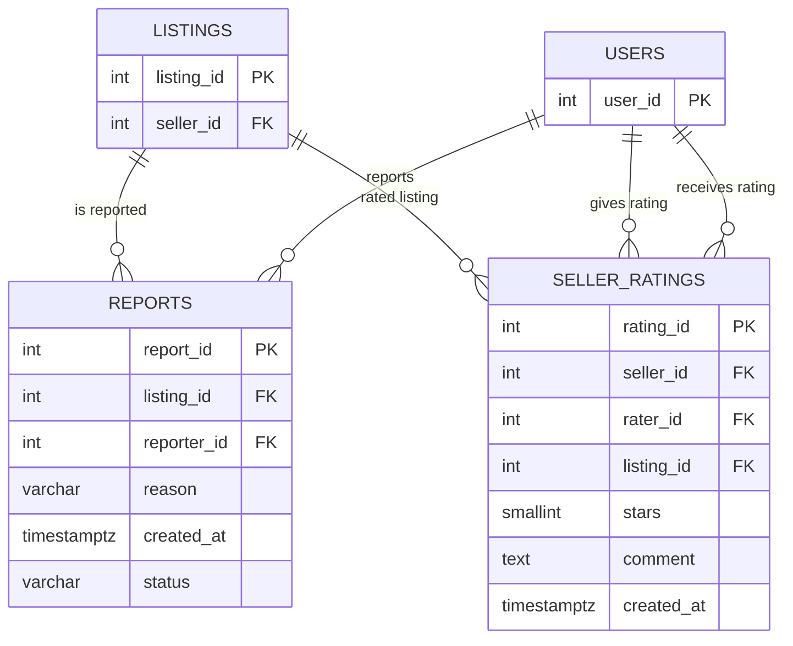

# ER Diagrams

## Diagram 1: Core Marketplace
Shows users, cities, categories, listings and boost packages.

## Diagram 2: Chat System
Shows buyers starting conversations about listings and users exchanging messages.

## Diagram 3: Offers and Favourites
Shows offers made by buyers and listings saved by users.

## Diagram 4: Reports and Seller Ratings
Shows users reporting listings and giving ratings to sellers.

