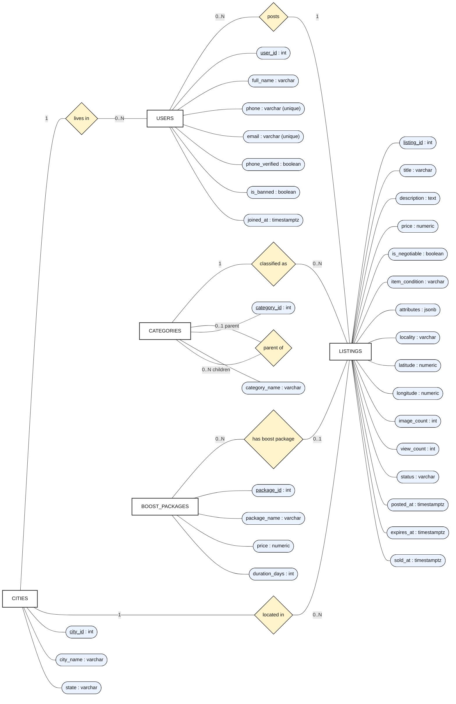
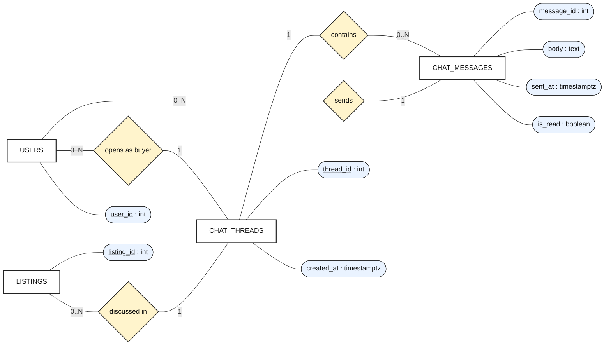
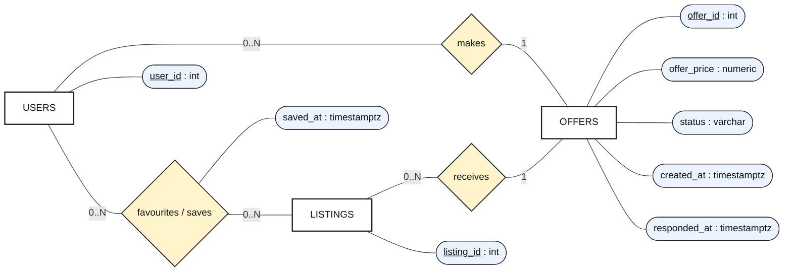
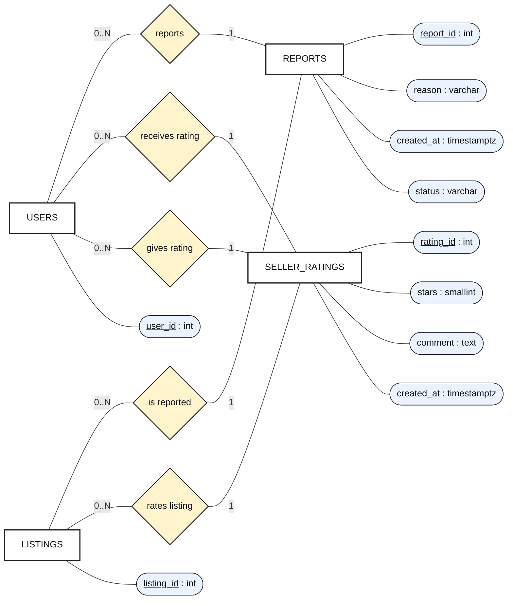

# ER Diagram
**Notation used**
- **Rectangles** represent entities.
- **Diamonds** represent relationships.
- **Ovals** represent attributes.
- Primary-key attributes are underlined.
- Cardinalities are written beside the relationship lines as `1`, `0..1`, or `0..N`.
- Foreign-key columns are represented by relationships rather than repeated as ordinary attributes. The FK columns still exist in the relational tables generated from this conceptual model.

---

## A. Core Marketplace

**Core relationship meaning**
- Every user belongs to exactly one city; a city can have zero or many users.
- Every listing belongs to exactly one city and one category; each city/category can be associated with zero or many listings.
- A category can have zero or one parent category. A parent category can have zero or many child categories.
- A listing can have zero or one boost package. A boost package can be used by zero or many listings.
- Every listing is posted by exactly one user; a user can post zero or many listings.

---

## B. Chat System

**Chat relationship meaning**
- Every chat thread has exactly one buyer; a user can open zero or many threads.
- Every chat thread is about exactly one listing; a listing can have zero or many threads.
- Every message belongs to exactly one thread; a thread can contain zero or many messages.
- Every message is sent by exactly one user; a user can send zero or many messages.

`USERS` and `LISTINGS` are the same entities shown in the Core Marketplace diagram. Their full attributes and the seller-posts-listing relationship are defined there; this chat diagram shows only the identifying keys needed by this part of the model.

---

## C. Offers and Favourites

**Offers and favourites relationship meaning**
- Every offer is made by exactly one user; a user can make zero or many offers.
- Every offer is for exactly one listing; a listing can receive zero or many offers.
- Users can save zero or many listings, and listings can be saved by zero or many users. Therefore, `FAVOURITES` is an **M:N relationship** in Chen notation.

In the relational schema, `FAVOURITES` is the junction table with composite primary key `(user_id, listing_id)`. In the Chen diagram, it is represented as the `favourites / saves` relationship, and `saved_at` is an attribute of that relationship.

---

## D. Reports and Seller Ratings

**Reports and seller ratings relationship meaning**
- Every report is submitted by exactly one user and concerns exactly one listing. A user can submit zero or many reports, and a listing can receive zero or many reports.
- Every seller rating identifies exactly one seller (the user receiving the rating), exactly one rater (the user giving the rating), and exactly one listing being rated.
- A user can receive zero or many seller ratings and can give zero or many seller ratings. A listing can have zero or many seller ratings.

The two relationships between `USERS` and `SELLER_RATINGS` are separate roles: **receives rating** uses `seller_id`, while **gives rating** uses `rater_id`.

`USERS` and `LISTINGS` are the same entities as in the Core Marketplace diagram. Their full attributes are defined there.

---