# Complete OLX Marketplace ER Diagram

This is the **single combined Chen ER diagram** for the OLX marketplace database. It combines the Core Marketplace, Chat System, Offers and Favourites, Reports, and Seller Ratings into one model.

## Chen notation used

- **Rectangles** represent entities.
- **Diamonds** represent relationships.
- **Ovals** represent attributes.
- Underlined attributes are **primary keys**.
- `1`, `0..1`, and `0..N` beside relationship lines show cardinality/participation.
- Foreign-key columns are represented by relationships rather than repeated as attribute ovals. Their names are explained in the relationship notes below.
- `FAVOURITES` is shown as an **M:N relationship** between `USERS` and `LISTINGS`; `saved_at` is an attribute of that relationship.

## Complete ER diagram

```mermaid
flowchart LR
    %% ============================================================
    %% ENTITIES — each entity appears only once in this whole ERD
    %% ============================================================
    CITIES[CITIES]
    USERS[USERS]
    CATEGORIES[CATEGORIES]
    BOOST_PACKAGES[BOOST_PACKAGES]
    LISTINGS[LISTINGS]
    CHAT_THREADS[CHAT_THREADS]
    CHAT_MESSAGES[CHAT_MESSAGES]
    OFFERS[OFFERS]
    REPORTS[REPORTS]
    SELLER_RATINGS[SELLER_RATINGS]

    %% ============================================================
    %% RELATIONSHIPS — CORE MARKETPLACE
    %% ============================================================
    R_USER_CITY{lives in}
    R_LISTING_CITY{located in}
    R_CLASSIFIES{classifies}
    R_PARENT{parent of}
    R_BOOST{has boost package}
    R_POSTS{posts}

    CITIES ---|1| R_USER_CITY
    R_USER_CITY ---|0..N| USERS

    CITIES ---|1| R_LISTING_CITY
    R_LISTING_CITY ---|0..N| LISTINGS

    CATEGORIES ---|1| R_CLASSIFIES
    R_CLASSIFIES ---|0..N| LISTINGS

    CATEGORIES ---|0..1 parent| R_PARENT
    R_PARENT ---|0..N children| CATEGORIES

    BOOST_PACKAGES ---|0..N| R_BOOST
    R_BOOST ---|0..1| LISTINGS

    USERS ---|0..N| R_POSTS
    R_POSTS ---|1| LISTINGS

    %% ============================================================
    %% RELATIONSHIPS — CHAT SYSTEM
    %% ============================================================
    R_BUYER_OPENS{opens as buyer}
    R_THREAD_LISTING{is about listing}
    R_CONTAINS{contains}
    R_SENDS{sends}

    USERS ---|0..N| R_BUYER_OPENS
    R_BUYER_OPENS ---|1| CHAT_THREADS

    LISTINGS ---|0..N| R_THREAD_LISTING
    R_THREAD_LISTING ---|1| CHAT_THREADS

    CHAT_THREADS ---|1| R_CONTAINS
    R_CONTAINS ---|0..N| CHAT_MESSAGES

    USERS ---|0..N| R_SENDS
    R_SENDS ---|1| CHAT_MESSAGES

    %% ============================================================
    %% RELATIONSHIPS — OFFERS AND FAVOURITES
    %% ============================================================
    R_MAKES{makes}
    R_RECEIVES_OFFER{receives offer}
    R_SAVES{saves / favourites}

    USERS ---|0..N| R_MAKES
    R_MAKES ---|1| OFFERS

    LISTINGS ---|0..N| R_RECEIVES_OFFER
    R_RECEIVES_OFFER ---|1| OFFERS

    USERS ---|0..N| R_SAVES
    R_SAVES ---|0..N| LISTINGS

    %% Relationship attribute for the M:N SAVES relationship
    A_SAVED_AT([saved_at : timestamptz])
    R_SAVES --- A_SAVED_AT

    %% ============================================================
    %% RELATIONSHIPS — REPORTS
    %% ============================================================
    R_SUBMITS_REPORT{submits report}
    R_REPORTS_LISTING{reports listing}

    USERS ---|0..N| R_SUBMITS_REPORT
    R_SUBMITS_REPORT ---|1| REPORTS

    LISTINGS ---|0..N| R_REPORTS_LISTING
    R_REPORTS_LISTING ---|1| REPORTS

    %% ============================================================
    %% RELATIONSHIPS — SELLER RATINGS
    %% USERS participates in two different roles:
    %% seller_id = receives rating; rater_id = gives rating
    %% ============================================================
    R_RECEIVES_RATING{receives rating}
    R_GIVES_RATING{gives rating}
    R_RATING_FOR_LISTING{rates listing}

    USERS ---|0..N| R_RECEIVES_RATING
    R_RECEIVES_RATING ---|1| SELLER_RATINGS

    USERS ---|0..N| R_GIVES_RATING
    R_GIVES_RATING ---|1| SELLER_RATINGS

    LISTINGS ---|0..N| R_RATING_FOR_LISTING
    R_RATING_FOR_LISTING ---|1| SELLER_RATINGS

    %% ============================================================
    %% ATTRIBUTES — CITIES
    %% ============================================================
    A_CITY_ID([<u>city_id</u> : int])
    A_CITY_NAME([city_name : varchar])
    A_CITY_STATE([state : varchar])
    CITIES --- A_CITY_ID
    CITIES --- A_CITY_NAME
    CITIES --- A_CITY_STATE

    %% ============================================================
    %% ATTRIBUTES — USERS
    %% ============================================================
    A_USER_ID([<u>user_id</u> : int])
    A_FULL_NAME([full_name : varchar])
    A_PHONE([phone : varchar, unique])
    A_EMAIL([email : varchar, unique])
    A_PHONE_VERIFIED([phone_verified : boolean])
    A_IS_BANNED([is_banned : boolean])
    A_JOINED_AT([joined_at : timestamptz])
    USERS --- A_USER_ID
    USERS --- A_FULL_NAME
    USERS --- A_PHONE
    USERS --- A_EMAIL
    USERS --- A_PHONE_VERIFIED
    USERS --- A_IS_BANNED
    USERS --- A_JOINED_AT

    %% ============================================================
    %% ATTRIBUTES — CATEGORIES
    %% ============================================================
    A_CATEGORY_ID([<u>category_id</u> : int])
    A_CATEGORY_NAME([category_name : varchar])
    CATEGORIES --- A_CATEGORY_ID
    CATEGORIES --- A_CATEGORY_NAME

    %% ============================================================
    %% ATTRIBUTES — BOOST_PACKAGES
    %% ============================================================
    A_PACKAGE_ID([<u>package_id</u> : int])
    A_PACKAGE_NAME([package_name : varchar])
    A_PACKAGE_PRICE([price : numeric])
    A_DURATION([duration_days : int])
    BOOST_PACKAGES --- A_PACKAGE_ID
    BOOST_PACKAGES --- A_PACKAGE_NAME
    BOOST_PACKAGES --- A_PACKAGE_PRICE
    BOOST_PACKAGES --- A_DURATION

    %% ============================================================
    %% ATTRIBUTES — LISTINGS
    %% ============================================================
    A_LISTING_ID([<u>listing_id</u> : int])
    A_TITLE([title : varchar])
    A_DESCRIPTION([description : text])
    A_LISTING_PRICE([price : numeric])
    A_NEGOTIABLE([is_negotiable : boolean])
    A_CONDITION([item_condition : varchar])
    A_ATTRIBUTES([attributes : jsonb])
    A_LOCALITY([locality : varchar])
    A_LATITUDE([latitude : numeric])
    A_LONGITUDE([longitude : numeric])
    A_IMAGE_COUNT([image_count : int])
    A_VIEW_COUNT([view_count : int])
    A_BOOSTED_STATUS([status : varchar])
    A_POSTED_AT([posted_at : timestamptz])
    A_EXPIRES_AT([expires_at : timestamptz])
    A_SOLD_AT([sold_at : timestamptz])
    LISTINGS --- A_LISTING_ID
    LISTINGS --- A_TITLE
    LISTINGS --- A_DESCRIPTION
    LISTINGS --- A_LISTING_PRICE
    LISTINGS --- A_NEGOTIABLE
    LISTINGS --- A_CONDITION
    LISTINGS --- A_ATTRIBUTES
    LISTINGS --- A_LOCALITY
    LISTINGS --- A_LATITUDE
    LISTINGS --- A_LONGITUDE
    LISTINGS --- A_IMAGE_COUNT
    LISTINGS --- A_VIEW_COUNT
    LISTINGS --- A_BOOSTED_STATUS
    LISTINGS --- A_POSTED_AT
    LISTINGS --- A_EXPIRES_AT
    LISTINGS --- A_SOLD_AT

    %% ============================================================
    %% ATTRIBUTES — CHAT_THREADS
    %% ============================================================
    A_THREAD_ID([<u>thread_id</u> : int])
    A_THREAD_CREATED([created_at : timestamptz])
    CHAT_THREADS --- A_THREAD_ID
    CHAT_THREADS --- A_THREAD_CREATED

    %% ============================================================
    %% ATTRIBUTES — CHAT_MESSAGES
    %% ============================================================
    A_MESSAGE_ID([<u>message_id</u> : int])
    A_BODY([body : text])
    A_SENT_AT([sent_at : timestamptz])
    A_IS_READ([is_read : boolean])
    CHAT_MESSAGES --- A_MESSAGE_ID
    CHAT_MESSAGES --- A_BODY
    CHAT_MESSAGES --- A_SENT_AT
    CHAT_MESSAGES --- A_IS_READ

    %% ============================================================
    %% ATTRIBUTES — OFFERS
    %% ============================================================
    A_OFFER_ID([<u>offer_id</u> : int])
    A_OFFER_PRICE([offer_price : numeric])
    A_OFFER_STATUS([status : varchar])
    A_OFFER_CREATED([created_at : timestamptz])
    A_OFFER_RESPONDED([responded_at : timestamptz])
    OFFERS --- A_OFFER_ID
    OFFERS --- A_OFFER_PRICE
    OFFERS --- A_OFFER_STATUS
    OFFERS --- A_OFFER_CREATED
    OFFERS --- A_OFFER_RESPONDED

    %% ============================================================
    %% ATTRIBUTES — REPORTS
    %% ============================================================
    A_REPORT_ID([<u>report_id</u> : int])
    A_REASON([reason : varchar])
    A_REPORT_CREATED([created_at : timestamptz])
    A_REPORT_STATUS([status : varchar])
    REPORTS --- A_REPORT_ID
    REPORTS --- A_REASON
    REPORTS --- A_REPORT_CREATED
    REPORTS --- A_REPORT_STATUS

    %% ============================================================
    %% ATTRIBUTES — SELLER_RATINGS
    %% ============================================================
    A_RATING_ID([<u>rating_id</u> : int])
    A_STARS([stars : smallint])
    A_COMMENT([comment : text])
    A_RATING_CREATED([created_at : timestamptz])
    SELLER_RATINGS --- A_RATING_ID
    SELLER_RATINGS --- A_STARS
    SELLER_RATINGS --- A_COMMENT
    SELLER_RATINGS --- A_RATING_CREATED

    %% ============================================================
    %% STYLING
    %% ============================================================
    classDef entity fill:#ffffff,stroke:#222222,stroke-width:2px,color:#111111;
    classDef relationship fill:#fff4cc,stroke:#222222,stroke-width:1.5px,color:#111111;
    classDef attribute fill:#eaf3ff,stroke:#222222,stroke-width:1px,color:#111111;

    class CITIES,USERS,CATEGORIES,BOOST_PACKAGES,LISTINGS,CHAT_THREADS,CHAT_MESSAGES,OFFERS,REPORTS,SELLER_RATINGS entity;
    class R_USER_CITY,R_LISTING_CITY,R_CLASSIFIES,R_PARENT,R_BOOST,R_POSTS,R_BUYER_OPENS,R_THREAD_LISTING,R_CONTAINS,R_SENDS,R_MAKES,R_RECEIVES_OFFER,R_SAVES,R_SUBMITS_REPORT,R_REPORTS_LISTING,R_RECEIVES_RATING,R_GIVES_RATING,R_RATING_FOR_LISTING relationship;
    class A_CITY_ID,A_CITY_NAME,A_CITY_STATE,A_USER_ID,A_FULL_NAME,A_PHONE,A_EMAIL,A_PHONE_VERIFIED,A_IS_BANNED,A_JOINED_AT,A_CATEGORY_ID,A_CATEGORY_NAME,A_PACKAGE_ID,A_PACKAGE_NAME,A_PACKAGE_PRICE,A_DURATION,A_LISTING_ID,A_TITLE,A_DESCRIPTION,A_LISTING_PRICE,A_NEGOTIABLE,A_CONDITION,A_ATTRIBUTES,A_LOCALITY,A_LATITUDE,A_LONGITUDE,A_IMAGE_COUNT,A_VIEW_COUNT,A_BOOSTED_STATUS,A_POSTED_AT,A_EXPIRES_AT,A_SOLD_AT,A_THREAD_ID,A_THREAD_CREATED,A_MESSAGE_ID,A_BODY,A_SENT_AT,A_IS_READ,A_OFFER_ID,A_OFFER_PRICE,A_OFFER_STATUS,A_OFFER_CREATED,A_OFFER_RESPONDED,A_REPORT_ID,A_REASON,A_REPORT_CREATED,A_REPORT_STATUS,A_RATING_ID,A_STARS,A_COMMENT,A_RATING_CREATED,A_SAVED_AT attribute;
```

