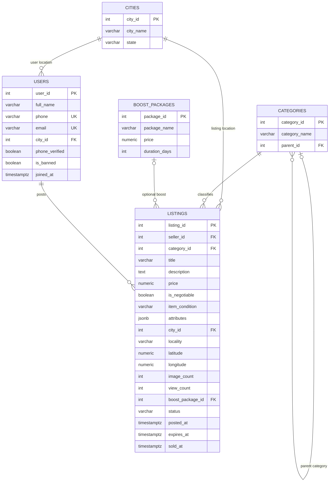
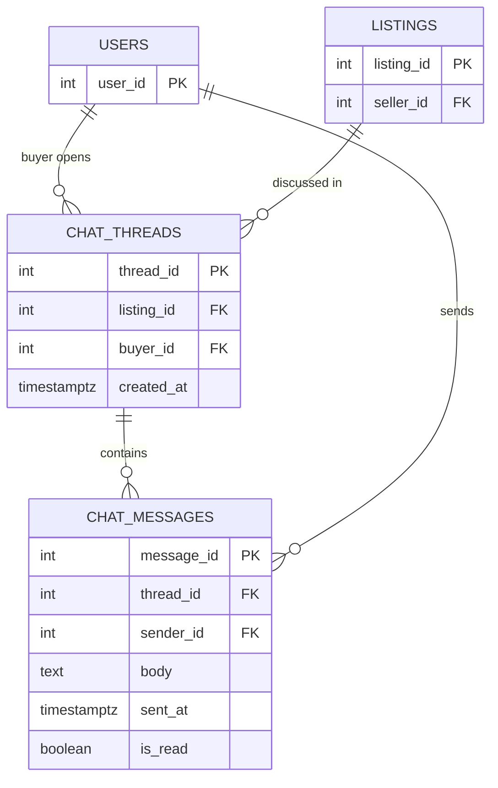
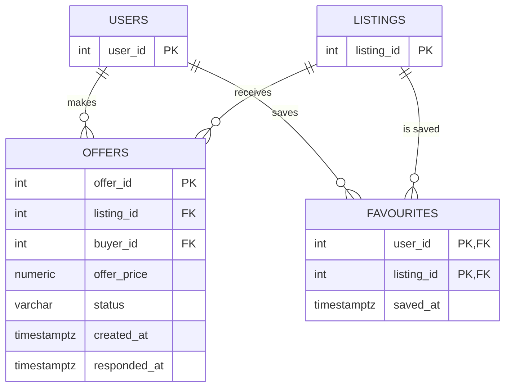
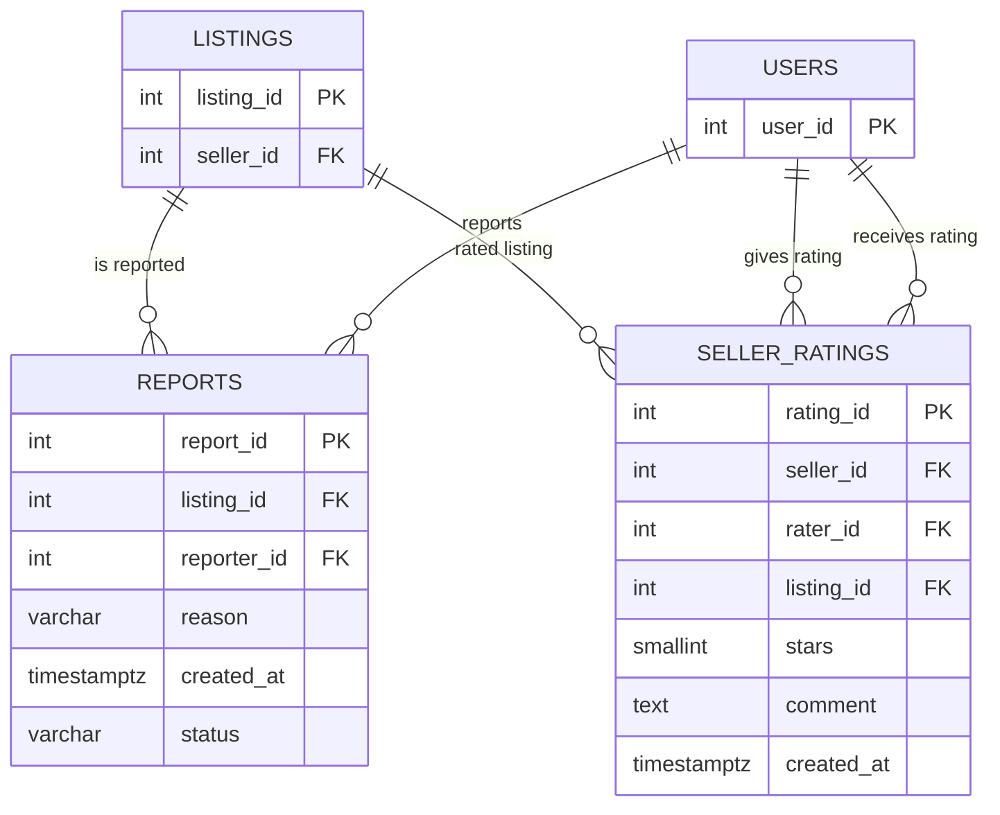

# Schema Design

## Database Overview
The OLX marketplace database needs to manage users, advertisements, categories, offers, chats, favourites, reports, ratings, and boost packages.
The main objective is to maintain organised data, enforce relationships between tables, and support efficient searching, communication, and marketplace operations.

Tables will be created inside the PostgreSQL schema `olx`.

# Tables

## Overview
The database contains 11 relational tables. The schema uses primary keys, foreign keys, unique constraints, NOT NULL constraints, and CHECK constraints to maintain data integrity.

The database contains the following 11 tables:

1. `cities`
2. `categories`
3. `boost_packages`
4. `users`
5. `listings`
6. `chat_threads`
7. `chat_messages`
8. `offers`
9. `favourites`
10. `reports`
11. `seller_ratings`

### 1. Cities
Stores the cities in which advertisements are located.

| Column | PostgreSQL Type | Constraints | Why |
|---|---|---|---|
| city_id | INTEGER | PRIMARY KEY, NOT NULL | Identifies the advertisement's city, which may differ from the seller's registered city. |
| city_name | VARCHAR(100) | NOT NULL | Stores the city label; required to identify the location. |
| state | VARCHAR(100) | NOT NULL | Distinguishes cities with similar names and records the state. |

### 2. Categories
Stores product categories and subcategories.

| Column | PostgreSQL Type | Constraints | Why |
|---|---|---|---|
| category_id | INTEGER | PRIMARY KEY, NOT NULL | Ensures every listing belongs to a valid category. |
| category_name | VARCHAR(100) | NOT NULL | Category label is needed for browsing and filtering. |
| parent_id | INTEGER | NULL allowed, FOREIGN KEY REFERENCES categories(category_id) | Supports a category hierarchy; NULL represents a top-level category. |

### 3. Boost Packages
Stores available advertisement promotion packages.

| Column | PostgreSQL Type | Constraints | Why |
|---|---|---|---|
| package_id | INTEGER | PRIMARY KEY, NOT NULL | Stable identifier for each promotion package. |
| package_name | VARCHAR(100) | NOT NULL | Human-readable package name. |
| price | NUMERIC(10,2) | NOT NULL, CHECK (price >= 0) | Exact decimal supports monetary values; negative prices are invalid. |
| duration_days | INTEGER | NOT NULL, CHECK (duration_days > 0) | A package must last at least one day. |

### 4. Users
Stores information about marketplace users. A user can act as both a buyer and a seller.

| Column | PostgreSQL Type | Constraints | Why |
|---|---|---|---|
| user_id | INTEGER | PRIMARY KEY, NOT NULL | Identifies the user who saved the listing. |
| full_name | VARCHAR(150) | NOT NULL | Stores the user's display/name information. |
| phone | VARCHAR(20) | UNIQUE, NOT NULL | Phone numbers are identifiers, not quantities; UNIQUE prevents two accounts sharing the same phone if that is the platform rule. |
| email | VARCHAR(255) | UNIQUE, NULL allowed | Email is optional but should not be duplicated when supplied. PostgreSQL permits multiple NULL values under a normal UNIQUE constraint. |
| city_id | INTEGER | FOREIGN KEY REFERENCES cities(city_id), NOT NULL | Identifies the advertisement's city, which may differ from the seller's registered city. |
| phone_verified | BOOLEAN | NOT NULL | Stores a yes/no verification state. |
| is_banned | BOOLEAN | NOT NULL | Stores whether the account is banned. |
| joined_at | TIMESTAMPTZ | NOT NULL | Records account creation time with time-zone-aware input handling. |

### 5. Listings
Stores advertisements posted by sellers.

| Column | PostgreSQL Type | Constraints | Why |
|---|---|---|---|
| listing_id | INTEGER | PRIMARY KEY, NOT NULL | Links the rating to the relevant advertisement/deal. |
| seller_id | INTEGER | FOREIGN KEY REFERENCES users(user_id), NOT NULL | Identifies the seller receiving the rating; should match the seller of listing_id. |
| category_id | INTEGER | FOREIGN KEY REFERENCES categories(category_id), NOT NULL | Ensures every listing belongs to a valid category. |
| title | VARCHAR(255) | NOT NULL | Short text used to identify and search for the item. |
| description | TEXT | NULL allowed | Longer details are optional because a listing may have no description. |
| price | NUMERIC(12,2) | NOT NULL, CHECK (price >= 0) | Exact decimal supports monetary values; negative prices are invalid. |
| is_negotiable | BOOLEAN | NOT NULL | Indicates whether the seller is willing to negotiate. |
| item_condition | VARCHAR(20) | NOT NULL, CHECK (item_condition IN ('FAIR', 'GOOD', 'LIKE_NEW', 'NEW')) | Restricts condition to the known business categories and prevents inconsistent spellings. |
| attributes | JSONB | NOT NULL | Allows category-specific structured attributes without adding a new column for every product category. Validate that the JSON shape matches the data and intended use. |
| city_id | INTEGER | FOREIGN KEY REFERENCES cities(city_id), NOT NULL | Identifies the advertisement's city, which may differ from the seller's registered city. |
| locality | VARCHAR(150) | NOT NULL | Stores a more specific area within the city. |
| latitude | NUMERIC(9,6) | NOT NULL, CHECK (latitude BETWEEN -90 AND 90) | Stores geographic latitude with decimal precision and valid global range. |
| longitude | NUMERIC(9,6) | NOT NULL, CHECK (longitude BETWEEN -180 AND 180) | Stores geographic longitude with decimal precision and valid global range. |
| image_count | INTEGER | NOT NULL, CHECK (image_count >= 0) | Number of images cannot be negative. |
| view_count | INTEGER | NOT NULL, CHECK (view_count >= 0) | Cached number of listing views cannot be negative. |
| boost_package_id | INTEGER | NULL allowed, FOREIGN KEY REFERENCES boost_packages(package_id) | Optional because an ordinary listing may not be promoted. |
| status | VARCHAR(20) | NOT NULL, CHECK (status IN ('ACTIVE', 'EXPIRED', 'REMOVED', 'SOLD')) | Tracks moderation progress using known states. |
| posted_at | TIMESTAMPTZ | NOT NULL | Records when the listing was published. |
| expires_at | TIMESTAMPTZ | NOT NULL | Records when the listing expires; can be checked against posted_at. |
| sold_at | TIMESTAMPTZ | NULL allowed | Only applicable after a listing is sold; NULL is expected for unsold listings. |

### 6. Chat Threads
Stores conversations related to advertisements.

| Column | PostgreSQL Type | Constraints | Why |
|---|---|---|---|
| thread_id | INTEGER | PRIMARY KEY, NOT NULL | Places the message in its conversation. |
| listing_id | INTEGER | FOREIGN KEY REFERENCES listings(listing_id), NOT NULL | Links the rating to the relevant advertisement/deal. |
| buyer_id | INTEGER | FOREIGN KEY REFERENCES users(user_id), NOT NULL | Identifies the user making the offer. |
| created_at | TIMESTAMPTZ | NOT NULL | Records when the rating was submitted. |

### 7. Chat Messages
Stores individual messages inside chat conversations.

| Column | PostgreSQL Type | Constraints | Why |
|---|---|---|---|
| message_id | INTEGER | PRIMARY KEY, NOT NULL | Uniquely identifies each message. |
| thread_id | INTEGER | FOREIGN KEY REFERENCES chat_threads(thread_id), NOT NULL | Places the message in its conversation. |
| sender_id | INTEGER | FOREIGN KEY REFERENCES users(user_id), NOT NULL | Identifies the account that sent the message. |
| body | TEXT | NOT NULL | Stores message content; messages require a body. |
| sent_at | TIMESTAMPTZ | NOT NULL | Records when the message was sent. |
| is_read | BOOLEAN | NOT NULL | Tracks whether the message has been read. |

### 8. Offers
Stores offers made by buyers for advertisements.

| Column | PostgreSQL Type | Constraints | Why |
|---|---|---|---|
| offer_id | INTEGER | PRIMARY KEY, NOT NULL | Uniquely identifies each offer; permits multiple offers over time. |
| listing_id | INTEGER | FOREIGN KEY REFERENCES listings(listing_id), NOT NULL | Links the rating to the relevant advertisement/deal. |
| buyer_id | INTEGER | FOREIGN KEY REFERENCES users(user_id), NOT NULL | Identifies the user making the offer. |
| offer_price | NUMERIC(12,2) | NOT NULL, CHECK (offer_price >= 0) | Stores the offered money amount exactly; negative values are invalid. |
| status | VARCHAR(20) | NOT NULL, CHECK (status IN ('ACCEPTED', 'COUNTERED', 'PENDING', 'REJECTED')) | Tracks moderation progress using known states. |
| created_at | TIMESTAMPTZ | NOT NULL | Records when the rating was submitted. |
| responded_at | TIMESTAMPTZ | NULL allowed | Remains NULL until the seller responds, if that is how the source data models pending offers. |

### 9. Favourites
Stores advertisements saved by users.

| Column | PostgreSQL Type | Constraints | Why |
|---|---|---|---|
| user_id | INTEGER | PRIMARY KEY, FOREIGN KEY REFERENCES users(user_id), NOT NULL | Identifies the user who saved the listing. |
| listing_id | INTEGER | PRIMARY KEY, FOREIGN KEY REFERENCES listings(listing_id), NOT NULL | Links the rating to the relevant advertisement/deal. |
| saved_at | TIMESTAMPTZ | NOT NULL | Records when the favourite was created. |

### 10. Reports
Stores reports submitted against advertisements.

| Column | PostgreSQL Type | Constraints | Why |
|---|---|---|---|
| report_id | INTEGER | PRIMARY KEY, NOT NULL | Uniquely identifies each report. |
| listing_id | INTEGER | FOREIGN KEY REFERENCES listings(listing_id), NOT NULL | Links the rating to the relevant advertisement/deal. |
| reporter_id | INTEGER | FOREIGN KEY REFERENCES users(user_id), NOT NULL | Identifies the user submitting the report. |
| reason | VARCHAR(30) | NOT NULL, CHECK (reason IN ('ALREADY_SOLD', 'FRAUD', 'OFFENSIVE', 'SPAM', 'WRONG_CATEGORY')) | Restricts reports to recognised reasons. |
| created_at | TIMESTAMPTZ | NOT NULL | Records when the rating was submitted. |
| status | VARCHAR(20) | NOT NULL, CHECK (status IN ('ACTIONED', 'DISMISSED', 'OPEN')) | Tracks moderation progress using known states. |

### 11. Seller Ratings
Stores ratings and feedback given to sellers.

| Column | PostgreSQL Type | Constraints | Why |
|---|---|---|---|
| rating_id | INTEGER | PRIMARY KEY, NOT NULL | Uniquely identifies a rating. |
| seller_id | INTEGER | FOREIGN KEY REFERENCES users(user_id), NOT NULL | Identifies the seller receiving the rating; should match the seller of listing_id. |
| rater_id | INTEGER | FOREIGN KEY REFERENCES users(user_id), NOT NULL | Identifies the user giving the rating. |
| listing_id | INTEGER | FOREIGN KEY REFERENCES listings(listing_id), NOT NULL | Links the rating to the relevant advertisement/deal. |
| stars | SMALLINT | NOT NULL, CHECK (stars BETWEEN 1 AND 5) | A small integer is sufficient for a 1–5 star score. |
| comment | TEXT | NULL allowed | Written feedback is optional. |
| created_at | TIMESTAMPTZ | NOT NULL | Records when the rating was submitted. |

# Primary Keys
| Table | Primary key |
|---|---|
| cities | `city_id` |
| categories | `category_id` |
| boost_packages | `package_id` |
| users | `user_id` |
| listings | `listing_id` |
| chat_threads | `thread_id` |
| chat_messages | `message_id` |
| offers | `offer_id` |
| favourites | `(user_id, listing_id)` |
| reports | `report_id` |
| seller_ratings | `rating_id` |

The `favourites` table has composite primary key (uses two or more columns together to uniquely identify a row) allowing one user can save multiple listings and multiple users can save the same listing.

# Relationships

| Parent table | Child table | Relationship |
|---|---|---|
| cities | users | One-to-Many |
| cities | listings | One-to-Many |
| categories | listings | One-to-Many |
| categories | categories | One-to-Many |
| boost_packages | listings | One-to-Many |
| users | listings | One-to-Many |
| listings | chat_threads | One-to-Many |
| users | chat_threads | One-to-Many |
| chat_threads | chat_messages | One-to-Many |
| users | chat_messages | One-to-Many |
| listings | offers | One-to-Many |
| users | offers | One-to-Many|
| users | favourites | One-to-Many |
| listings | favourites | One-to-Many |
| listings | reports | One-to-Many |
| users | reports | One-to-Many |
| users | seller_ratings(seller_id) | One-to-Many  |
| users | seller_ratings(rater_id)| One-to-Many |
| listings | seller_ratings | One-to-Many |

# ER Diagram

The Mermaid ER diagram below represents all 11 tables and their relationships. `||` means exactly one, `o{` means zero or many, and `o|` means zero or one.

Core Marketplace

Chat System

Offers and Favourites

Reports and Seller Ratings



# Database Constraints
We plan to use the following constraints:

1. Every table must have a primary key.
2. cities.city_name cannot be NULL.
3. categories.category_name cannot be NULL.
4. boost_packages.price must be greater than or equal to zero.
5. boost_packages.duration_days must be greater than zero.
6. listings.price must be greater than or equal to zero.
7. listings.image_count must be greater than or equal to zero.
8. listings.view_count must be greater than or equal to zero.
9. listings.latitude must be between -90 and 90.
10. listings.longitude must be between -180 and 180.
11. offers.offer_price must be greater than zero.
12. seller_ratings.stars must be between 1 and 5.
13. favourites must have a composite primary key on (user_id, listing_id).
14. categories.parent_id must reference an existing category.
15. Foreign keys must reference valid records in their respective parent tables.

# Additional Constraint Design and Business Rules

The original constraints above are retained. The following additional checks are candidates for the final SQL after confirming that every seed-data row obeys them.

| Proposed constraint / rule | Purpose | Implementation note |
|---|---|---|
| `listings.expires_at > listings.posted_at` | A listing should expire after it is posted. | Row-level CHECK. |
| `listings.sold_at IS NULL OR listings.sold_at >= listings.posted_at` | A listing cannot be sold before it was posted. | Row-level CHECK. |
| `(status = 'SOLD') = (sold_at IS NOT NULL)` | Keeps sold status and sold timestamp consistent. | Add only if the seed data follows this exact rule. |
| `offers.responded_at IS NULL OR offers.responded_at >= offers.created_at` | A response cannot precede the offer. | Row-level CHECK. |
| `status <> 'PENDING' OR responded_at IS NULL` | Pending offers should not have a response timestamp. | Add only if this matches all source rows. |
| `rater_id <> seller_id` | Prevents a seller from rating themselves. | Row-level CHECK. |
| `buyer_id <> listing.seller_id` for chat threads | Prevents a seller from opening a buyer chat on their own listing. | Requires cross-table enforcement (trigger or application validation); a normal CHECK cannot query another table. |
| Message sender is thread buyer or listing seller | Restricts chat messages to the two participants. | Requires a trigger or application validation because it spans tables. |
| `UNIQUE (listing_id, buyer_id)` on chat_threads | Enforces one thread per buyer/listing pair. | Add only if this is the intended rule and duplicate pairs do not exist. |
| `UNIQUE (listing_id, reporter_id)` on reports | Prevents a user reporting the same listing more than once. | Add only if the business requires it and the data supports it. |
| `UNIQUE (rater_id, listing_id)` on seller_ratings | Prevents duplicate ratings by the same user for the same listing. | Add only if the business requires it and the data supports it. |
| `attributes` must be a JSON object | Prevents scalar/array JSON values if attributes are intended as key-value properties. | PostgreSQL CHECK can use `jsonb_typeof(attributes) = 'object'`; confirm source shape first. |

**Important correction to the original list:** the original item 11 says `offers.offer_price` must be greater than zero, while the table definition says `CHECK (offer_price >= 0)`. These are different rules. The final choice must follow the business requirement and the actual data. The current table definition uses `>= 0`; change it to `> 0` only if zero-price offers are invalid and no seed row has a zero offer.

## Foreign-key ON DELETE Policy

The following is the recommended default policy for this dataset. The final SQL should state each action explicitly.

| Foreign key | Recommended ON DELETE | Reason |
|---|---|---|
| `categories.parent_id → categories.category_id` | RESTRICT | Do not delete a parent category while subcategories still depend on it. |
| `users.city_id → cities.city_id` | RESTRICT | Preserve user location references; update the user first if a city must be changed. |
| `listings.category_id → categories.category_id` | RESTRICT | Do not remove a category that is still used by listings. |
| `listings.city_id → cities.city_id` | RESTRICT | Do not remove a city referenced by listings. |
| `listings.seller_id → users.user_id` | RESTRICT | Preserve marketplace history; account deletion should be handled deliberately. |
| `listings.boost_package_id → boost_packages.package_id` | SET NULL | A listing can remain even if an optional package is removed. |
| `chat_threads.listing_id → listings.listing_id` | RESTRICT | Preserve conversation history rather than silently deleting it with a listing. |
| `chat_threads.buyer_id → users.user_id` | RESTRICT | Preserve the identity reference in conversation history. |
| `chat_messages.thread_id → chat_threads.thread_id` | CASCADE (if threads are intentionally deletable) | Messages have no independent meaning without their thread. Use RESTRICT instead if chat history must be retained. |
| `chat_messages.sender_id → users.user_id` | RESTRICT | Preserve sender references in message history. |
| `offers.listing_id → listings.listing_id` | RESTRICT | Preserve offers linked to a listing. |
| `offers.buyer_id → users.user_id` | RESTRICT | Preserve offer ownership/history. |
| `favourites.user_id → users.user_id` | CASCADE | A user's saved-list rows can be removed with that user's account. |
| `favourites.listing_id → listings.listing_id` | CASCADE | A favourite row has no purpose if its listing is removed. |
| `reports.listing_id → listings.listing_id` | RESTRICT | Preserve moderation records. |
| `reports.reporter_id → users.user_id` | RESTRICT | Preserve report attribution. |
| `seller_ratings.seller_id → users.user_id` | RESTRICT | Preserve rating history and seller reference. |
| `seller_ratings.rater_id → users.user_id` | RESTRICT | Preserve rating attribution. |
| `seller_ratings.listing_id → listings.listing_id` | RESTRICT | Preserve the listing/deal context for the rating. |

For this coursework seed load, parent rows are loaded before child rows. ON DELETE actions do not change the load order.

# Normalisation

## 1. Functional Dependencies (FDs)

A functional dependency `X → Y` means that the value of column(s) `X` determines exactly one value for column(s) `Y`. For example, `city_id → city_name, state` means each city ID identifies one city name and state.

The following are the intended functional dependencies based on the proposed primary keys and business meaning. These should be confirmed against the CSV data and any additional candidate keys discovered during inspection.

| Table | Functional dependencies |
|---|---|
| cities | `city_id → city_name, state` |
| categories | `category_id → category_name, parent_id` |
| boost_packages | `package_id → package_name, price, duration_days` |
| users | `user_id → full_name, phone, email, city_id, phone_verified, is_banned, joined_at`; if phone is unique, `phone → user_id, full_name, email, city_id, phone_verified, is_banned, joined_at`; if non-NULL email is unique, `email → user_id, full_name, phone, city_id, phone_verified, is_banned, joined_at` |
| listings | `listing_id → seller_id, category_id, title, description, price, is_negotiable, item_condition, attributes, city_id, locality, latitude, longitude, image_count, view_count, boost_package_id, status, posted_at, expires_at, sold_at` |
| chat_threads | `thread_id → listing_id, buyer_id, created_at`; if one chat per buyer per listing is the rule, `(listing_id, buyer_id) → thread_id, created_at` |
| chat_messages | `message_id → thread_id, sender_id, body, sent_at, is_read` |
| offers | `offer_id → listing_id, buyer_id, offer_price, status, created_at, responded_at` |
| favourites | `(user_id, listing_id) → saved_at` |
| reports | `report_id → listing_id, reporter_id, reason, created_at, status`; if one report per reporter per listing is the rule, `(listing_id, reporter_id) → report_id, reason, created_at, status` |
| seller_ratings | `rating_id → seller_id, rater_id, listing_id, stars, comment, created_at`; if one rating per rater per listing is the rule, `(rater_id, listing_id) → rating_id, seller_id, stars, comment, created_at` |

A proposed FD based on a business rule must not be treated as a database-enforced dependency until the corresponding UNIQUE constraint is implemented and validated against the seed data.

## 2. Normal Form Per Table

The assessment below assumes each listed primary key is valid, each column stores one value per row, and no unlisted dependencies exist. Final confirmation depends on checking the actual CSV data and candidate keys.

| Table | Normal form assessment | Reason |
|---|---|---|
| cities | 3NF / BCNF (expected) | `city_id` is the key and determines the city attributes. No partial dependency is possible with a single-column key. |
| categories | 3NF / BCNF (expected) | `category_id` determines `category_name` and `parent_id`. `parent_id` points to another category and does not itself determine the row. |
| boost_packages | 3NF / BCNF (expected) | `package_id` determines the package name, price, and duration. |
| users | 3NF / BCNF (expected) | `user_id` determines the user attributes. Unique phone and non-NULL unique email, if confirmed, are candidate keys too. |
| listings | 3NF / BCNF (expected, subject to JSON review) | `listing_id` determines listing attributes. `attributes` is a JSONB value; it should contain a single structured value for the listing and should not be used to hide repeating relational records. |
| chat_threads | 3NF / BCNF (expected) | `thread_id` determines the listing, buyer, and creation time. A unique `(listing_id, buyer_id)` rule may provide an additional candidate key if required by the business. |
| chat_messages | 3NF / BCNF (expected) | `message_id` determines the message's thread, sender, body, timestamp, and read state. |
| offers | 3NF / BCNF (expected) | `offer_id` determines all offer attributes. Repeated offers by the same buyer on the same listing may be valid, so do not assume `(listing_id, buyer_id)` is unique without evidence. |
| favourites | 3NF / BCNF (expected) | Both columns of the composite key are needed to identify a saved listing. `saved_at` depends on the full pair. |
| reports | 3NF / BCNF (expected) | `report_id` determines the report attributes. Whether the same reporter can report the same listing more than once must be checked before adding a composite UNIQUE constraint. |
| seller_ratings | 3NF / BCNF (expected, subject to business rule) | `rating_id` determines the rating attributes. A unique `(rater_id, listing_id)` constraint can prevent repeat ratings if that is the intended rule and the data supports it. |

## 3. Derived or Potentially Redundant Columns

| Column / relationship | Why it may be redundant | Decision |
|---|---|---|
| `listings.view_count` | It can be derived by counting view events, if individual view events are stored. | Keep it as a cached counter if the system needs fast display and no view-event table is part of this project. It must be updated consistently. |
| `seller_ratings.seller_id` vs `listings.seller_id` | The seller for a listing can be obtained by joining `seller_ratings.listing_id` to `listings`. Storing both can allow a rating's seller to disagree with the listing's actual seller. | It may be retained if the supplied CSV and required queries use it. Add an integrity rule (for example, a trigger or composite FK design) if the project must guarantee that the rating seller equals the listing seller. A simple FK to `users` alone does not enforce this equality. |
| `chat_threads` vs listing seller | The seller can be obtained through `chat_threads.listing_id → listings.seller_id`; the thread stores `buyer_id` but not seller ID. | Do not add a seller column to `chat_threads` unless the data or query requirements demand it. Retrieve the seller through the listing. |
| `users.city_id` and `listings.city_id` | Both identify locations but describe different things: a user's registered city and an advertisement's location. | Keep both; they are not duplicates of the same fact. |

# Data Inspection, Integrity Checks and Data Problems

## 1. Inspection Status

**Audit limitation:** The complete set of 11 original CSV files was not available in the files attached to this conversation when this document was generated. Therefore, exact row counts, all-column null counts, duplicate-key counts, complete value domains, and cross-table integrity results cannot honestly be reported here. They must be filled from the actual seed files or from the loaded `olx` schema. Do not treat proposed constraints as proven to fit the seed data until the load succeeds.

One previously inspected file, `chat_messages.csv`, had the following observed properties:

| Check | Observed result |
|---|---:|
| Rows | 209,529 |
| Columns | 6 |
| Headers | `message_id`, `thread_id`, `sender_id`, `body`, `sent_at`, `is_read` |
| NULL values | 0 across the inspected columns |
| `message_id` range | 1 to 209,529 |
| `thread_id` range | 1 to 60,000 |
| `sender_id` range | 1 to 50,000 |
| `is_read = TRUE` | 209,271 |
| `is_read = FALSE` | 258 |
| Timestamp example format | `2026-03-04 11:05:14+05:30` |

This supports using `INTEGER` for the three identifier columns, `TEXT` for message body, `TIMESTAMPTZ` for `sent_at`, and `BOOLEAN` for `is_read`, subject to checking the corresponding parent CSVs and exact key compatibility.

## 2. Data Problems / Design Issues Already Identified

| # | Problem or risk | Evidence / explanation | Required action |
|---|---|---|---|
| 1 | `chat_threads` key/type mismatch in an earlier draft | The earlier SQL shown for `chat_threads` used `id SERIAL PRIMARY KEY`, while `thread_id` was `TEXT`. `chat_messages.thread_id` is `INTEGER` and is intended to reference `chat_threads.thread_id`. | Use one consistent integer `thread_id` as the primary key in `chat_threads`, or explicitly convert both sides to the same type and reference the actual primary/unique key. Do not keep the earlier `id`/TEXT design as-is. |
| 2 | `offers.offer_price` rule is inconsistent | The table definition uses `CHECK (offer_price >= 0)`, but the written constraint list says greater than zero. | Inspect the CSV and confirm the business rule; use one consistent condition in the schema and document. |
| 3 | Potentially duplicate chat threads | The requirement asks what prevents a buyer opening two chats about the same ad. A primary key on `thread_id` alone does not prevent duplicate `(listing_id, buyer_id)` pairs. | Check duplicate pairs. Add `UNIQUE (listing_id, buyer_id)` only if the business rule is intended and no duplicates exist. |
| 4 | Potentially duplicate reports | A primary key on `report_id` does not prevent the same user reporting the same listing repeatedly. | Check `(listing_id, reporter_id)` duplicates. Add a composite UNIQUE constraint only if required by the rules and supported by the data. |
| 5 | Potentially duplicate ratings | A primary key on `rating_id` does not prevent the same user rating the same listing more than once. | Check `(rater_id, listing_id)` duplicates. Add a composite UNIQUE constraint only if required and supported by the data. |
| 6 | Rating seller may disagree with listing seller | `seller_ratings` stores `seller_id` as well as `listing_id`, while the listing already identifies its seller. Two independent FKs do not guarantee they refer to the same seller. | Run a mismatch check. If the column is required, enforce consistency with a suitable composite foreign key or trigger. |
| 7 | Chat participant consistency is not guaranteed by basic FKs | A message sender can reference any valid user unless checked against the thread buyer and listing seller. | Run the participant check and use a trigger/application rule if required. |
| 8 | Status/timestamp consistency is not yet enforced | A listing could theoretically have status `SOLD` with NULL `sold_at`, or a non-SOLD status with a timestamp. | Inspect source rows and add a CHECK only if the intended rule is true for all rows. |
| 9 | NULL semantics need validation | `description`, `email`, `comment`, `parent_id`, `boost_package_id`, `sold_at`, and `responded_at` are marked optional in the proposed schema, but their actual null patterns have not all been verified against all CSVs. | Calculate NULL counts and inspect sample rows for each field before finalising nullability. |
| 10 | `attributes` JSON shape is unverified | JSONB is proposed, but the expected shape (object, array, scalar, or mixed) must be checked from the source. | Inspect distinct JSON types and representative values before adding a JSON shape CHECK. |

## 3. NULL Values to Investigate

| Table.column | Proposed handling | What to verify |
|---|---|---|
| `users.email` | NULL allowed | Whether some users have no email; whether non-NULL values are unique. |
| `listings.description` | NULL allowed | Whether blank descriptions are represented as NULL or empty strings. |
| `listings.boost_package_id` | NULL allowed | Expected for listings that have not purchased/applied a boost. |
| `listings.sold_at` | NULL allowed | Expected for listings not marked sold; compare with `status`. |
| `offers.responded_at` | NULL allowed | Expected for offers not yet answered; compare with `status`. |
| `seller_ratings.comment` | NULL allowed | Expected when a user submits stars without written feedback. |
| `categories.parent_id` | NULL allowed | Expected for top-level categories. |

## 4. Integrity Check SQL

Run these after loading all 11 tables. They are designed to return zero violating rows when the corresponding business rule is valid. Paste the actual result counts from PostgreSQL into the Result column below.

### Check 1: No listing is sold before it was posted

```sql
SELECT COUNT(*) AS violations
FROM olx.listings
WHERE sold_at IS NOT NULL
  AND sold_at < posted_at;
```

### Check 2: No listing expires before it was posted

```sql
SELECT COUNT(*) AS violations
FROM olx.listings
WHERE expires_at <= posted_at;
```

### Check 3: A chat buyer is not the seller of the listing

```sql
SELECT COUNT(*) AS violations
FROM olx.chat_threads ct
JOIN olx.listings l ON l.listing_id = ct.listing_id
WHERE ct.buyer_id = l.seller_id;
```

### Check 4: Every chat message sender is either the thread buyer or listing seller

```sql
SELECT COUNT(*) AS violations
FROM olx.chat_messages cm
JOIN olx.chat_threads ct ON ct.thread_id = cm.thread_id
JOIN olx.listings l ON l.listing_id = ct.listing_id
WHERE cm.sender_id NOT IN (ct.buyer_id, l.seller_id);
```

### Check 5: Seller on a rating matches the seller of the rated listing

```sql
SELECT COUNT(*) AS violations
FROM olx.seller_ratings sr
JOIN olx.listings l ON l.listing_id = sr.listing_id
WHERE sr.seller_id <> l.seller_id;
```

### Check 6: A user has not rated their own seller account

```sql
SELECT COUNT(*) AS violations
FROM olx.seller_ratings
WHERE rater_id = seller_id;
```

### Check 7: No duplicate buyer/listing chat pairs

```sql
SELECT COUNT(*) AS duplicate_groups
FROM (
    SELECT listing_id, buyer_id
    FROM olx.chat_threads
    GROUP BY listing_id, buyer_id
    HAVING COUNT(*) > 1
) d;
```

### Check 8: No duplicate reporter/listing report pairs

```sql
SELECT COUNT(*) AS duplicate_groups
FROM (
    SELECT listing_id, reporter_id
    FROM olx.reports
    GROUP BY listing_id, reporter_id
    HAVING COUNT(*) > 1
) d;
```

### Check 9: No duplicate rater/listing rating pairs

```sql
SELECT COUNT(*) AS duplicate_groups
FROM (
    SELECT listing_id, rater_id
    FROM olx.seller_ratings
    GROUP BY listing_id, rater_id
    HAVING COUNT(*) > 1
) d;
```

## 5. Integrity Check Results

**Results are pending execution against the complete seed data.** No zero-violation result is claimed without running the SQL above on the loaded database.

| Check | Expected result if rule holds | Actual result |
|---|---:|---|
| Sold timestamp is not before posting | 0 violations | PENDING — run Check 1 |
| Expiry is after posting | 0 violations | PENDING — run Check 2 |
| Buyer is not own listing's seller | 0 violations | PENDING — run Check 3 |
| Message sender is buyer or listing seller | 0 violations | PENDING — run Check 4 |
| Rating seller matches listing seller | 0 violations | PENDING — run Check 5 |
| Rater is not the seller | 0 violations | PENDING — run Check 6 |
| No duplicate chat pairs | 0 duplicate groups if one-thread rule applies | PENDING — run Check 7 |
| No duplicate report pairs | 0 duplicate groups if one-report rule applies | PENDING — run Check 8 |
| No duplicate rating pairs | 0 duplicate groups if one-rating rule applies | PENDING — run Check 9 |

## 6. Row Count Verification

After loading the files, run:

```sql
SELECT 'cities' AS table_name, COUNT(*) AS row_count FROM olx.cities
UNION ALL SELECT 'categories', COUNT(*) FROM olx.categories
UNION ALL SELECT 'boost_packages', COUNT(*) FROM olx.boost_packages
UNION ALL SELECT 'users', COUNT(*) FROM olx.users
UNION ALL SELECT 'listings', COUNT(*) FROM olx.listings
UNION ALL SELECT 'chat_threads', COUNT(*) FROM olx.chat_threads
UNION ALL SELECT 'chat_messages', COUNT(*) FROM olx.chat_messages
UNION ALL SELECT 'offers', COUNT(*) FROM olx.offers
UNION ALL SELECT 'favourites', COUNT(*) FROM olx.favourites
UNION ALL SELECT 'reports', COUNT(*) FROM olx.reports
UNION ALL SELECT 'seller_ratings', COUNT(*) FROM olx.seller_ratings
ORDER BY table_name;
```

Compare each result with the source CSV line count minus its header row. The expected counts from the complete project data summary should be recorded here after verification; do not infer them from partial files.

| Table | CSV data rows | PostgreSQL rows | Match? |
|---|---:|---:|---|
| cities | PENDING | PENDING | PENDING |
| categories | PENDING | PENDING | PENDING |
| boost_packages | PENDING | PENDING | PENDING |
| users | PENDING | PENDING | PENDING |
| listings | PENDING | PENDING | PENDING |
| chat_threads | PENDING | PENDING | PENDING |
| chat_messages | 209,529 (previously inspected) | PENDING | PENDING |
| offers | PENDING | PENDING | PENDING |
| favourites | PENDING | PENDING | PENDING |
| reports | PENDING | PENDING | PENDING |
| seller_ratings | PENDING | PENDING | PENDING |

# Loading Order and Schema Setup

Create the schema and set the search path before creating tables:

```sql
CREATE SCHEMA IF NOT EXISTS olx;
SET search_path TO olx;
```

Recommended parent-before-child load order:

1. `cities`
2. `categories`
3. `boost_packages`
4. `users`
5. `listings`
6. `chat_threads`
7. `chat_messages`
8. `offers`
9. `favourites`
10. `reports`
11. `seller_ratings`

A corresponding `sql/02_load_data.sql` should use `\copy` with the exact CSV headers and file paths, for example:

```sql
SET search_path TO olx;

\copy cities FROM 'seed_data/cities.csv' WITH (FORMAT csv, HEADER true)
\copy categories FROM 'seed_data/categories.csv' WITH (FORMAT csv, HEADER true)
\copy boost_packages FROM 'seed_data/boost_packages.csv' WITH (FORMAT csv, HEADER true)
\copy users FROM 'seed_data/users.csv' WITH (FORMAT csv, HEADER true)
\copy listings FROM 'seed_data/listings.csv' WITH (FORMAT csv, HEADER true)
\copy chat_threads FROM 'seed_data/chat_threads.csv' WITH (FORMAT csv, HEADER true)
\copy chat_messages FROM 'seed_data/chat_messages.csv' WITH (FORMAT csv, HEADER true)
\copy offers FROM 'seed_data/offers.csv' WITH (FORMAT csv, HEADER true)
\copy favourites FROM 'seed_data/favourites.csv' WITH (FORMAT csv, HEADER true)
\copy reports FROM 'seed_data/reports.csv' WITH (FORMAT csv, HEADER true)
\copy seller_ratings FROM 'seed_data/seller_ratings.csv' WITH (FORMAT csv, HEADER true)

ANALYZE;
```

Run this with `psql` from the project root (or adjust the paths). `\copy` is a psql command, not ordinary SQL, so it should be run by the psql client.

# Indexes in This Phase

No additional performance indexes should be created in this phase. PostgreSQL automatically creates indexes to enforce PRIMARY KEY and UNIQUE constraints. These constraint-backed indexes are allowed. Foreign-key columns are not automatically indexed by PostgreSQL. Any additional indexes for query performance should be considered in the later optimisation phase, after recording the baseline.

# Final Validation Checklist

- [ ] Confirm exact CSV file names and headers for all 11 tables.
- [ ] Confirm data types from actual values, including integer ranges, decimal precision, booleans, JSON structure, and timezone-aware timestamps.
- [ ] Confirm primary-key uniqueness and absence of NULL primary-key values.
- [ ] Confirm candidate UNIQUE keys (phone, email, and any composite business keys) against the data.
- [ ] Count NULLs in every column and inspect why optional values are missing.
- [ ] Check every foreign key for orphan references before adding the constraint.
- [ ] Confirm allowed values for condition, listing status, offer status, report reason, and report status.
- [ ] Confirm the `attributes` JSONB shape.
- [ ] Resolve the `chat_threads.thread_id` type/key mismatch before loading messages.
- [ ] Run all integrity checks and paste actual results above.
- [ ] Compare PostgreSQL row counts with CSV data-row counts.
- [ ] Confirm the schema creation and load scripts run top-to-bottom on an empty database.
- [ ] Keep the baseline free of non-constraint performance indexes.
