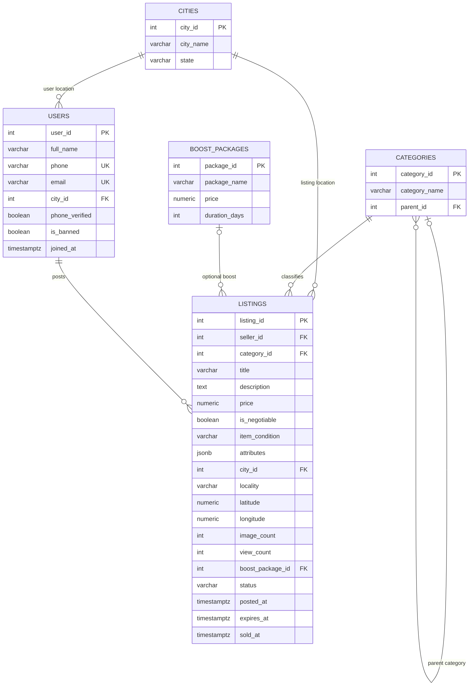
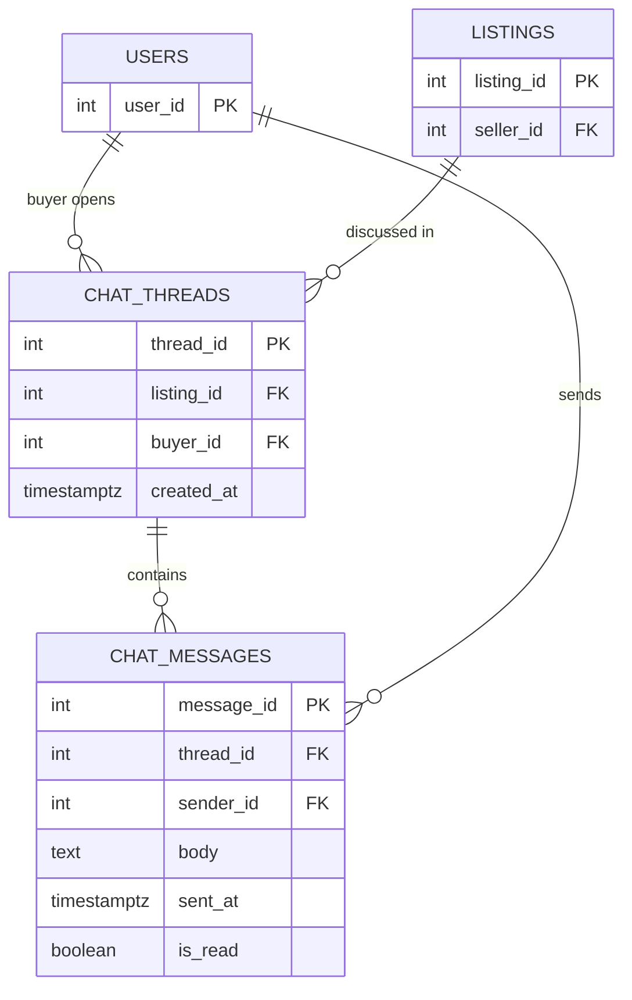
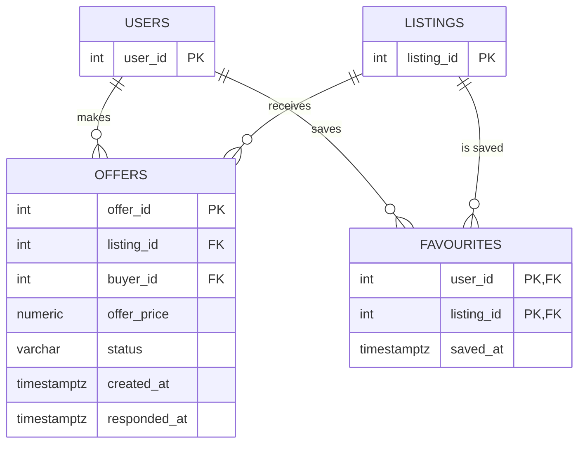
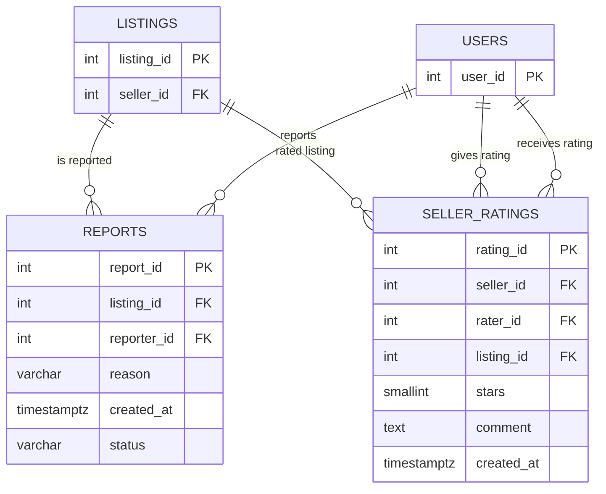

# OLX Used Goods Marketplace Database — Schema Design

## 1. Database Overview
The OLX marketplace database needs to manage users, advertisements, categories, offers, chats, favourites, reports, ratings, and boost packages.
The main objective is to maintain organised data, enforce relationships between tables, and support efficient searching, communication, and marketplace operations.

Tables will be created inside the PostgreSQL schema `olx`.

## 2. Tables

### 2.1 Overview
The database contains 11 relational tables. The schema uses primary keys, foreign keys, unique constraints, NOT NULL constraints, and CHECK constraints to maintain data integrity.

The database contains the following 11 tables:

1. `cities`
2. `categories`
3. `boost_packages`
4. `users`
5. `listings`
6. `chat_threads`
7. `chat_messages`
8. `offers`
9. `favourites`
10. `reports`
11. `seller_ratings`

### 2.2 Data Dictionary
The following tables describe each column, its PostgreSQL type, its proposed constraints, and why the column is required.

### 1. Cities
Stores the cities in which advertisements and users are located.

| Column | PostgreSQL Type | Constraints | Why |
|---|---|---|---|
| city_id | INTEGER | PRIMARY KEY, NOT NULL | Uniquely identifies each city and is referenced by users and listings. |
| city_name | VARCHAR(100) | NOT NULL | Stores the city name used for location-based browsing and reporting. |
| state | VARCHAR(100) | NOT NULL | Stores the state in which the city is located. |

### 2. Categories
Stores product categories and subcategories.

| Column | PostgreSQL Type | Constraints | Why |
|---|---|---|---|
| category_id | INTEGER | PRIMARY KEY, NOT NULL | Uniquely identifies each category. |
| category_name | VARCHAR(100) | NOT NULL | Stores the category name used to classify listings. |
| parent_id | INTEGER | NULL allowed, FOREIGN KEY REFERENCES categories(category_id) | Links a subcategory to its parent category. It is NULL for a top-level category. |

### 3. Boost Packages
Stores available advertisement promotion packages.

| Column | PostgreSQL Type | Constraints | Why |
|---|---|---|---|
| package_id | INTEGER | PRIMARY KEY, NOT NULL | Uniquely identifies each boost package. |
| package_name | VARCHAR(100) | NOT NULL | Stores the package name shown to users. |
| price | NUMERIC(10,2) | NOT NULL, CHECK (price >= 0) | Stores the package price accurately using a decimal type and prevents negative prices. |
| duration_days | INTEGER | NOT NULL, CHECK (duration_days > 0) | Stores how long the boost lasts and prevents zero or negative durations. |

### 4. Users
Stores information about marketplace users. A user can act as both a buyer and a seller.

| Column | PostgreSQL Type | Constraints | Why |
|---|---|---|---|
| user_id | INTEGER | PRIMARY KEY, NOT NULL | Uniquely identifies each marketplace user and is referenced by activity tables. |
| full_name | VARCHAR(150) | NOT NULL | Stores the user's name for account and marketplace display. |
| phone | VARCHAR(20) | UNIQUE, NOT NULL | Stores the mobile number used for login and contact; it must be present and unique. |
| email | VARCHAR(255) | UNIQUE, NULL allowed | Stores an optional email address. It may be empty when a user has not supplied one. |
| city_id | INTEGER | FOREIGN KEY REFERENCES cities(city_id), NOT NULL | Identifies the user's city and links it to the cities table. |
| phone_verified | BOOLEAN | NOT NULL | Records whether the user's phone number has been verified. |
| is_banned | BOOLEAN | NOT NULL | Records whether the account is banned. |
| joined_at | TIMESTAMPTZ | NOT NULL | Stores the account creation time, including its time-zone offset. |

### 5. Listings
Stores advertisements posted by sellers.

| Column | PostgreSQL Type | Constraints | Why |
|---|---|---|---|
| listing_id | INTEGER | PRIMARY KEY, NOT NULL | Uniquely identifies each advertisement. |
| seller_id | INTEGER | FOREIGN KEY REFERENCES users(user_id), NOT NULL | Identifies the user who posted the advertisement. |
| category_id | INTEGER | FOREIGN KEY REFERENCES categories(category_id), NOT NULL | Identifies the category to which the advertisement belongs. |
| title | VARCHAR(255) | NOT NULL | Stores the advertisement title used in search results and listing pages. |
| description | TEXT | NULL allowed | Stores additional details about the item. It can be empty if the seller does not provide a description. |
| price | NUMERIC(12,2) | NOT NULL, CHECK (price >= 0) | Stores the asking price accurately and prevents negative prices. |
| is_negotiable | BOOLEAN | NOT NULL | Records whether the seller is willing to negotiate the asking price. |
| item_condition | VARCHAR(20) | NOT NULL, CHECK (item_condition IN ('FAIR', 'GOOD', 'LIKE_NEW', 'NEW')) | Stores the item's condition using the allowed condition values. |
| attributes | JSONB | NOT NULL | Stores category-specific details, such as car fuel type or phone storage, without requiring separate columns for every category. |
| city_id | INTEGER | FOREIGN KEY REFERENCES cities(city_id), NOT NULL | Identifies the city in which the advertisement is located. |
| locality | VARCHAR(150) | NOT NULL | Stores the local area or neighbourhood for more specific location information. |
| latitude | NUMERIC(9,6) | NOT NULL, CHECK (latitude BETWEEN -90 AND 90) | Stores the geographic latitude and prevents values outside the valid range. |
| longitude | NUMERIC(9,6) | NOT NULL, CHECK (longitude BETWEEN -180 AND 180) | Stores the geographic longitude and prevents values outside the valid range. |
| image_count | INTEGER | NOT NULL, CHECK (image_count >= 0) | Stores the number of images attached to the advertisement and prevents negative counts. |
| view_count | INTEGER | NOT NULL, CHECK (view_count >= 0) | Stores the number of views. It is a maintained counter used for marketplace statistics. |
| boost_package_id | INTEGER | NULL allowed, FOREIGN KEY REFERENCES boost_packages(package_id) | Identifies the purchased boost package. It is NULL when the advertisement has not been boosted. |
| status | VARCHAR(20) | NOT NULL, CHECK (status IN ('ACTIVE', 'EXPIRED', 'REMOVED', 'SOLD')) | Records the current advertisement status using allowed values. |
| posted_at | TIMESTAMPTZ | NOT NULL | Stores when the advertisement was posted, including its time-zone offset. |
| expires_at | TIMESTAMPTZ | NOT NULL | Stores when the advertisement is due to expire. |
| sold_at | TIMESTAMPTZ | NULL allowed | Stores when the item was sold. It is NULL when the advertisement has not been sold. |

### 6. Chat Threads
Stores conversations related to advertisements.

| Column | PostgreSQL Type | Constraints | Why |
|---|---|---|---|
| thread_id | INTEGER | PRIMARY KEY, NOT NULL | Uniquely identifies each conversation. |
| listing_id | INTEGER | FOREIGN KEY REFERENCES listings(listing_id), NOT NULL | Identifies the advertisement about which the conversation is taking place. |
| buyer_id | INTEGER | FOREIGN KEY REFERENCES users(user_id), NOT NULL | Identifies the buyer who started the conversation. |
| created_at | TIMESTAMPTZ | NOT NULL | Stores when the conversation was created. |

### 7. Chat Messages
Stores individual messages inside chat conversations.

| Column | PostgreSQL Type | Constraints | Why |
|---|---|---|---|
| message_id | INTEGER | PRIMARY KEY, NOT NULL | Uniquely identifies each message. |
| thread_id | INTEGER | FOREIGN KEY REFERENCES chat_threads(thread_id), NOT NULL | Identifies the conversation to which the message belongs. |
| sender_id | INTEGER | FOREIGN KEY REFERENCES users(user_id), NOT NULL | Identifies the user who sent the message. |
| body | TEXT | NOT NULL | Stores the message content. |
| sent_at | TIMESTAMPTZ | NOT NULL | Stores when the message was sent. |
| is_read | BOOLEAN | NOT NULL | Records whether the message has been read. |

### 8. Offers
Stores offers made by buyers for advertisements.

| Column | PostgreSQL Type | Constraints | Why |
|---|---|---|---|
| offer_id | INTEGER | PRIMARY KEY, NOT NULL | Uniquely identifies each offer. |
| listing_id | INTEGER | FOREIGN KEY REFERENCES listings(listing_id), NOT NULL | Identifies the advertisement for which the offer was made. |
| buyer_id | INTEGER | FOREIGN KEY REFERENCES users(user_id), NOT NULL | Identifies the buyer who made the offer. |
| offer_price | NUMERIC(12,2) | NOT NULL, CHECK (offer_price >= 0) | Stores the buyer's offered amount accurately and prevents negative values. |
| status | VARCHAR(20) | NOT NULL, CHECK (status IN ('ACCEPTED', 'COUNTERED', 'PENDING', 'REJECTED')) | Records the current offer status using allowed values. |
| created_at | TIMESTAMPTZ | NOT NULL | Stores when the offer was created. |
| responded_at | TIMESTAMPTZ | NULL allowed | Stores when the seller responded. It is NULL while no response has been recorded. |

### 9. Favourites
Stores advertisements saved by users.

| Column | PostgreSQL Type | Constraints | Why |
|---|---|---|---|
| user_id | INTEGER | PRIMARY KEY, FOREIGN KEY REFERENCES users(user_id), NOT NULL | Identifies the user who saved the advertisement and forms part of the composite primary key. |
| listing_id | INTEGER | PRIMARY KEY, FOREIGN KEY REFERENCES listings(listing_id), NOT NULL | Identifies the saved advertisement and forms part of the composite primary key. |
| saved_at | TIMESTAMPTZ | NOT NULL | Stores when the user saved the advertisement. |

### 10. Reports
Stores reports submitted against advertisements.

| Column | PostgreSQL Type | Constraints | Why |
|---|---|---|---|
| report_id | INTEGER | PRIMARY KEY, NOT NULL | Uniquely identifies each report. |
| listing_id | INTEGER | FOREIGN KEY REFERENCES listings(listing_id), NOT NULL | Identifies the advertisement being reported. |
| reporter_id | INTEGER | FOREIGN KEY REFERENCES users(user_id), NOT NULL | Identifies the user who submitted the report. |
| reason | VARCHAR(30) | NOT NULL, CHECK (reason IN ('ALREADY_SOLD', 'FRAUD', 'OFFENSIVE', 'SPAM', 'WRONG_CATEGORY')) | Stores the reason for the report using allowed values. |
| created_at | TIMESTAMPTZ | NOT NULL | Stores when the report was submitted. |
| status | VARCHAR(20) | NOT NULL, CHECK (status IN ('ACTIONED', 'DISMISSED', 'OPEN')) | Records the moderation status of the report. |

### 11. Seller Ratings
Stores ratings and feedback given to sellers.

| Column | PostgreSQL Type | Constraints | Why |
|---|---|---|---|
| rating_id | INTEGER | PRIMARY KEY, NOT NULL | Uniquely identifies each seller rating. |
| seller_id | INTEGER | FOREIGN KEY REFERENCES users(user_id), NOT NULL | Identifies the seller receiving the rating. |
| rater_id | INTEGER | FOREIGN KEY REFERENCES users(user_id), NOT NULL | Identifies the user who submitted the rating. |
| listing_id | INTEGER | FOREIGN KEY REFERENCES listings(listing_id), NOT NULL | Identifies the advertisement associated with the rating. |
| stars | SMALLINT | NOT NULL, CHECK (stars BETWEEN 1 AND 5) | Stores the rating score and restricts it to the valid 1–5 range. |
| comment | TEXT | NULL allowed | Stores optional written feedback. It can be NULL when the user gives only a star rating. |
| created_at | TIMESTAMPTZ | NOT NULL | Stores when the rating was submitted. |

## 3. Primary Keys

| Table | Primary key |
|---|---|
| cities | `city_id` |
| categories | `category_id` |
| boost_packages | `package_id` |
| users | `user_id` |
| listings | `listing_id` |
| chat_threads | `thread_id` |
| chat_messages | `message_id` |
| offers | `offer_id` |
| favourites | `(user_id, listing_id)` |
| reports | `report_id` |
| seller_ratings | `rating_id` |

The `favourites` table has a composite primary key (uses two or more columns together to uniquely identify a row), allowing one user to save multiple listings and multiple users to save the same listing. The combination prevents the same user from saving the same listing more than once.

## 4. Relationships

| Parent table | Child table | Relationship |
|---|---|---|
| cities | users | One-to-Many |
| cities | listings | One-to-Many |
| categories | listings | One-to-Many |
| categories | categories | One-to-Many (self-referencing parent/subcategory) |
| boost_packages | listings | One-to-Many; a listing may have no package |
| users | listings | One-to-Many |
| listings | chat_threads | One-to-Many |
| users | chat_threads | One-to-Many (as buyer) |
| chat_threads | chat_messages | One-to-Many |
| users | chat_messages | One-to-Many (as sender) |
| listings | offers | One-to-Many |
| users | offers | One-to-Many (as buyer) |
| users | favourites | One-to-Many |
| listings | favourites | One-to-Many |
| listings | reports | One-to-Many |
| users | reports | One-to-Many (as reporter) |
| users | seller_ratings (`seller_id`) | One-to-Many (as rated seller) |
| users | seller_ratings (`rater_id`) | One-to-Many (as rating author) |
| listings | seller_ratings | One-to-Many |

The `favourites` table resolves the many-to-many relationship between users and listings: one user can favourite many listings, and one listing can be favourited by many users.

## 5. ER Diagram

### 5.1 Mermaid ER Diagram Code

Core Marketplace


Chat System


Offers and Favourites


Reports and Seller Ratings


# Functional Dependencies (FDs)
A functional dependency `X → Y` means that X determines Y.

| Table | Functional dependency |
|---|---|
| cities | `city_id → city_name, state` |
| categories | `category_id → category_name, parent_id` |
| boost_packages | `package_id → package_name, price, duration_days` |
| users | `user_id → all other user columns` |
| listings | `listing_id → all other listing columns` |
| chat_threads | `thread_id → listing_id, buyer_id, created_at` |
| chat_messages | `message_id → all other message columns` |
| offers | `offer_id → all other offer columns` |
| favourites | `(user_id, listing_id) → saved_at` |
| reports | `report_id → all other report columns` |
| seller_ratings | `rating_id → all other rating columns` |

# Normal Form Per Table
All tables are expected to be in **3NF**. They are also expected to be in **BCNF** if the listed primary keys (and any confirmed candidate keys) are valid.

| Table | Normal form | Reason |
|---|---|---|
| cities | BCNF | City ID determines the city details. |
| categories | BCNF | Category ID determines the category details. |
| boost_packages | BCNF | Package ID determines package details. |
| users | BCNF | User ID determines user details. |
| listings | BCNF | Listing ID determines listing details. |
| chat_threads | BCNF | Thread ID determines conversation details. |
| chat_messages | BCNF | Message ID determines message details. |
| offers | BCNF | Offer ID determines offer details. |
| favourites | BCNF | The two-column key determines the saved timestamp. |
| reports | BCNF | Report ID determines report details. |
| seller_ratings | BCNF | Rating ID determines rating details. |

This assessment is based on the proposed keys and columns. It should be confirmed if data inspection reveals additional functional dependencies.

# Integrity-Check Results

<!-- Run these checks after loading the data. Record the actual result returned by PostgreSQL. -->
<!-- Need to do -->
| Check | SQL condition | Result |
|---|---|---|
| Listing sold before posting | `sold_at < posted_at` where `sold_at IS NOT NULL` | PENDING |
| Listing expires before posting | `expires_at <= posted_at` | PENDING |
| Buyer chats on own listing | `chat_threads.buyer_id = listings.seller_id` | PENDING |
| Message sent by someone outside the chat | Sender is neither the buyer nor listing seller | PENDING |
| Rating seller differs from listing seller | `seller_ratings.seller_id <> listings.seller_id` | PENDING |
| User rates themselves | `rater_id = seller_id` | PENDING |

<!-- Queries: -->

<!-- ```sql
-- 1. Sold before posted
-- SELECT COUNT(*)
-- FROM olx.listings
-- WHERE sold_at IS NOT NULL AND sold_at < posted_at;

-- -- 2. Expires before or at posted time
-- SELECT COUNT(*)
-- FROM olx.listings
-- WHERE expires_at <= posted_at;

-- -- 3. Buyer chats about their own listing
-- SELECT COUNT(*)
-- FROM olx.chat_threads ct
-- JOIN olx.listings l ON l.listing_id = ct.listing_id
-- WHERE ct.buyer_id = l.seller_id;

-- -- 4. Message sender is not a buyer or seller
-- SELECT COUNT(*)
-- FROM olx.chat_messages cm
-- JOIN olx.chat_threads ct ON ct.thread_id = cm.thread_id
-- JOIN olx.listings l ON l.listing_id = ct.listing_id
-- WHERE cm.sender_id NOT IN (ct.buyer_id, l.seller_id);

-- -- 5. Rating seller does not match listing seller
-- SELECT COUNT(*)
-- FROM olx.seller_ratings sr
-- JOIN olx.listings l ON l.listing_id = sr.listing_id
-- WHERE sr.seller_id <> l.seller_id;

-- -- 6. User rates themselves
-- SELECT COUNT(*)
-- FROM olx.seller_ratings
-- WHERE rater_id = seller_id;
-- ``` -->

# Data Problems Found

| Problem | Details / action |
|---|---|
| `chat_threads` key/type mismatch in an earlier SQL draft | The earlier draft used `id SERIAL` as the primary key and made `thread_id` TEXT. `chat_messages.thread_id` is INTEGER. Use `thread_id INTEGER PRIMARY KEY` in `chat_threads` so the foreign key matches. |
| `offers.offer_price` constraint mismatch | The column definition says `>= 0`, while the constraint list says `> 0`. Check the CSV and use one rule consistently. |
| Possible duplicate chat, report, or rating pairs | The primary keys do not prevent duplicate buyer/listing chats, reporter/listing reports, or rater/listing ratings. Check the data before adding UNIQUE constraints. |
| Possible seller mismatch in ratings | `seller_ratings.seller_id` should match the seller of the related listing. Check this with the integrity query above. |
| Possible invalid chat participants | Basic foreign keys do not ensure that a message sender is the buyer or seller in that conversation. Check this with the integrity query above. |

**Note:** The complete set of 11 CSV files has not been checked. Therefore, the integrity results above are marked PENDING, and no additional data errors or zero-violation results are claimed. Need to test them soon. 
